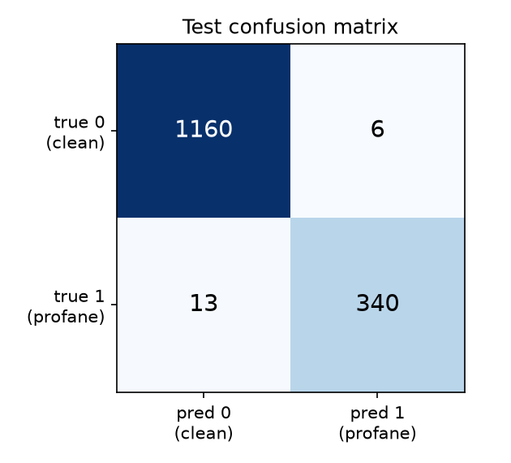
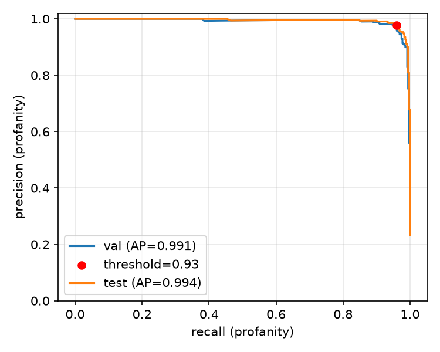

# Kazakh Profanity Detection

DSSC5113 Algorithms of Computer Vision · Bonus project · KBTU, Fall 2026

**Author:** Aizhan Kakharman · Student ID: `25MD0215`

A fine-tuned **GLiNER** model (multilingual mDeBERTa-v3 backbone) that reads one Kazakh product review or
comment and predicts whether it contains **Kazakh profanity**:

* **0** = no Kazakh profanity, **1** = profanity present
* **score** = probability-like confidence (the highest probability among the detected words), shown next to the label
* the model also returns **which words** are profane, which powers two extras: blacking out profanity in
  documents (PDF / DOCX / TXT) and bleeping it in videos (ffmpeg + GigaAM speech recognition)

**Held-out test set** (1,519 real reviews, 353 profane; threshold 0.93 chosen on validation):

| Model | Precision | Recall | F1 | FP | FN |
|---|---:|---:|---:|---:|---:|
| **Fine-tuned GLiNER (this repo)** | **0.983** | **0.963** | **0.973** | 6 | 13 |
| Baseline: char n-gram TF-IDF + logistic regression | 0.967 | 0.921 | 0.943 | 11 | 28 |

---

## Contents

1. [Task definition](#1-task-definition)
2. [Repository layout](#2-repository-layout)
3. [Dataset](#3-dataset)
4. [Model](#4-model)
5. [Setup and reproduction](#5-setup-and-reproduction)
6. [Predicting on new comments](#6-predicting-on-new-comments)
7. [Results](#7-results)
8. [Error analysis](#8-error-analysis)
9. [Extras: documents and video](#9-extras-documents-and-video)
10. [Limitations](#10-limitations)
11. [AI assistance and own contributions](#11-ai-assistance-and-own-contributions)

---

## 1. Task definition

Input: one comment (a sentence or a short review). Output: a binary label and a score.

A comment is **profane (1)** if it contains at least one **obscene word**. A negative review is **not**
automatically profane; rude words that are not obscene are **0**. The exact rules are in
[3.3 Labelling rules](#33-labelling-rules).

## 2. Repository layout

```
configs/train.json            training settings (model, seed, learning rates, epochs, ...)
data/processed/               train / val / test splits (JSONL) + stats.json   <- the dataset used
data/review/                  manual labelling decisions (word forms, single comments)
kzprof/lexicon.py             rules used ONLY to pre-label the data (not used by the model)
kzprof/synthetic.py           synthetic training examples (train split only)
kzprof/text_utils.py          cleaning, personal-information scrubbing, duplicate keys
kzprof/inference.py           ProfanityDetector: load the model, predict label/score/words
kzprof/redact.py              black out profanity in PDF / DOCX / TXT
kzprof/video.py               bleep profanity in video/audio (ffmpeg + GigaAM + the model)
scripts/prepare_data.py       build the dataset from KazSAnDRA
scripts/train.py              fine-tune GLiNER
scripts/evaluate.py           pick the threshold on val, evaluate once on test
scripts/predict.py            predict on your own text (CLI / interactive)
scripts/redact_document.py    CLI for documents
scripts/censor_video.py       CLI for video/audio
app.py                        Gradio web demo (text, document, video tabs)
notebooks/colab.ipynb         runs in a fresh Google Colab runtime
results/                      test metrics, confusion matrix, PR curve, predictions, errors
examples/                     sample PDF / DOCX / TXT / MP4 for the extras
```

## 3. Dataset

### 3.1 Source and access

All texts come from **KazSAnDRA** — *Kazakh Sentiment Analysis Dataset of Reviews and Attitudes*
(ISSAI, Nazarbayev University; 180,064 reviews; licence **CC BY 4.0**):
<https://github.com/IS2AI/KazSAnDRA> · <https://huggingface.co/datasets/issai/kazsandra>.

`scripts/prepare_data.py` downloads the three original score-classification files
(`06_sc_train_ib`, `09_sc_valid`, `10_sc_test`, 175,158 reviews with 1–5 stars and a domain) from the GitHub
repository, so no account or token is needed. The processed splits used for training and evaluation are
committed in `data/processed/`.

**Relation to product reviews.** KazSAnDRA reviews come from four domains: `market` (online marketplace reviews
of physical goods), `appstore` (reviews of mobile apps and games — digital products), `bookstore` (books) and
`mapping` (places/services on a map service). All four are user reviews of products or services. Real
profanity, however, is almost entirely in `appstore` (2,555 of the 175k reviews contain it, versus 18 in
`market`). The dataset therefore keeps all domains, over-samples `market` among clean reviews, adds synthetic
profane `market` reviews to the training split, and reports test results per domain.

KazSAnDRA's original labels are **sentiment stars**, not profanity. They were not used as labels — only to
sample 1–2-star (negative) reviews, so that "negative but clean" is well represented. Profanity and sentiment
really are different things here: 1,093 of the 2,471 real profane reviews have **5 stars**
(e.g. "**Пиздец** ойын екен" — "a f***ing great game").

### 3.2 Labelling method

1. **Rule-based pre-labelling** (`kzprof/lexicon.py`): every word is lower-cased, repeated letters are
   collapsed (`қотаааақ` → `қотақ`) and matched against word-start patterns that cover Kazakh letters typed on
   a Russian keyboard (`қ→к`, `і→и/ы`, `ғ→г`), Latin transliteration and `*` masks. An exclusion list holds
   ordinary words that look similar (`көтеру` "to lift", `сигнал`, `ебі` "knack", `сиқыр` "magic",
   `жапырақ` "leaf", `скин`, `педикюр`, ...). Each obscene word becomes a character span.
2. **Manual decisions for ambiguous word forms** (`data/review/word_decisions.csv`, 51 forms): every
   `*`-masked word and the forms the rules could not decide were checked in context.
3. **Manual decisions for single comments** (`data/review/example_overrides.csv`): comments where context flips
   the word rule (e.g. `ұсын амын` is the verb *ұсынамын* "I recommend" split by a space, not the obscene
   `амын`).
4. **Audit**: 70 random validation labels were checked while building the rules (2 errors found and fixed),
   then 100 random **test** labels (50 profane, 50 clean) were checked before any model prediction was seen:
   0/50 clean labels wrong, 2/50 profane labels wrong (both fixed via overrides, one more left as ambiguous).
   Estimated label noise: ~2–4 % among profane comments, low among clean ones.

The pre-labelling rules are a data-preparation tool. The model never sees them; it learns from the labelled
examples and generalises to forms the rules do not list (see the error analysis).

### 3.3 Labelling rules

| Case | Label | Examples |
|---|---|---|
| Kazakh obscene words and derivatives (genitals, sexual acts, anus) | 1 | қотақ, қотақбас, ам, амы, сігейін, сіккен, көт, көтіңе |
| Kazakh sexual slurs | 1 | жәлеп, сайқал, қаншық |
| Russian mat **inside a Kazakh or mixed comment** (code-switching is normal in Kazakh reviews) | 1 | бля, блять, біләт, пиздец/пиздес, хуйня, нахуй, заебал/зайбал, далбаёб/далбайоп, сука |
| Masked words, when the visible letters identify the word | 1 | қо\*ақ, бл\*ть, с\*\*ейін, н\*х\*й |
| Spelling variants: Russian keyboard, Latin, stretched letters | 1 | котак, сигейн, qotaq, pizdes, қотааақ |
| Rude but **not obscene** words | 0 | ақымақ, мал, есек/ешак, боқ, қатын, сасық, лох, тупой, говно, блин |
| Euphemisms and minced curses | 0 | далбаса, далбан, капец, әкеңнің аузы |
| Unrecognisable masks, abbreviations | 0 | Ш\*\*\*\*\*\*\*\*\*\*, шшс |
| Negative review without obscene words | 0 | "Сапасы нашар, алғаныма өкінем" |
| Look-alike ordinary words | 0 | көтереді, сигнал, ебін тауып, коты (= "код", code) |

Ambiguous cases are decided by the most common meaning of the form in this corpus and documented: `көтен`
("rectum / bottom", used in diaper reviews) is 0, while `көтек` (insult) is 1; `коты` alone means "code" in
app reviews (0), while `котынды`/`котине` (with possessive endings) are `көт` typed with `о` (1).

### 3.4 Labelled examples

Profane words are shown between ⟦ ⟧.

| Label | Domain, stars | Comment |
|---|---|---|
| 1 | appstore, 5★ | ⟦Пиздец⟧ ойын екен даже гуглда жокко сурактары |
| 1 | appstore, 5★ | Ну норм негізі ⟦қо\*ақ⟧ 🤣🤣🤣 |
| 1 | appstore, 2★ | Sgin unamait ⟦kotak⟧ oiyngo bul dalbaeop ⟦suka⟧ |
| 1 | appstore, 1★ | Интернат стемиды котски катп кала береді актив жақсы ⟦блять⟧ |
| 1 | market, synthetic | Керемет ұзартатын тушь, ⟦нихуя⟧. |
| 0 | market, 1★ | Сапасы нашар, өлшемілері бірдей кесілмеген, қийсық, алғаныма өкінем |
| 0 | appstore, 2★ | Кім мал сол қолын көтерсін |
| 0 | market, 5★ | Жақсы, балама ұнады. Бірақ 7 жас балаға, өзі көтергенге ауыр, ыңғайсыз |
| 0 | appstore, 5★ | Фф боқ қо пабктан |

### 3.5 Sampling, synthetic data, duplicates and splits

* **Positives**: all real KazSAnDRA reviews with profanity (≤120 words).
* **Negatives**: 1,500 *hard negatives* (contain rude-but-not-obscene or look-alike words) plus per-domain
  quotas — market 3,000, appstore 2,600, mapping 700, bookstore 400 — half of each quota from 1–2-star reviews.
* **Exact duplicates** removed after normalising case, punctuation, emoji and letter repetition
  (10,761 → 10,637 comments).
* **Near-duplicates** grouped with MinHash-LSH on character 3-grams (Jaccard ≥ 0.7); a group never crosses
  splits (10,307 groups).
* **Split**: `StratifiedGroupKFold`, 70 / 15 / 15, stratified by label, grouped by near-duplicate group,
  **seed 42**. Two runs with different `PYTHONHASHSEED` produce byte-identical splits.
* **Synthetic examples — train split only, `source = "synthetic"`**: 500 real `market` reviews with one real
  obscene word inserted (30 % of them obfuscated) and 400 obfuscated copies of real train positives (`*` mask,
  Latin, Russian keyboard, stretched letters). Each keeps the group of its source review. Validation and test
  are 100 % real reviews.

| Split | Total | Profane (1) | Clean (0) | Synthetic | Hard negatives |
|---|---:|---:|---:|---:|---:|
| train | 8,496 | 2,665 | 5,831 | 900 | 1,225 |
| val | 1,518 | 353 | 1,165 | 0 | 249 |
| test | 1,519 | 353 | 1,166 | 0 | 246 |
| **total** | **11,533** | **3,371** | **8,162** | **900** | |

Real comments: 10,633, of which 2,471 profane (23 %). Natural prevalence in KazSAnDRA is ≈1.5 %; the sample is
enriched so that the model sees enough positives (see Limitations).

### 3.6 Personal information

KazSAnDRA has no reviewer names or user ids in the texts we use. Before splitting, URLs, e-mails, phone,
card and ID (IIN) numbers and `@handles` are replaced with `[URL]`, `[EMAIL]`, `[PHONE]`, `[CARD]`, `[ID]`,
`[USER]`. Person names mentioned inside reviews (e.g. "Рахмет Айгерім!") are replaced with `[NAME]` using the
base GLiNER model in zero-shot mode (label "person", threshold 0.7, capitalised words only, kinship words and
"Алла" excluded): 816 replacements.

## 4. Model

### 4.1 Why GLiNER

[GLiNER](https://github.com/urchade/GLiNER) is a span-detection model: given a text and a label name it scores
every span of 1–12 words. The base checkpoint `urchade/gliner_multi-v2.1` (Apache-2.0) uses the multilingual
**mDeBERTa-v3-base** encoder, pre-trained on CC100 including Kazakh. Reasons:

* it is **trainable on a laptop GPU** (289 M parameters, 97 M trained) and already understands Kazakh subwords;
* it gives **word-level evidence** — the comment-level label is explained by the words that triggered it, which
  is what a moderator needs and what the document/video extras use;
* a span model handles the main difficulty of this task — profanity is usually **one word** inside an otherwise
  normal review — without being distracted by the overall (often negative) sentiment.

The task asks for a binary classifier; the comment-level decision is derived from the spans:

```
score(comment) = max probability over all spans for the label "profanity"   (0 if no span)
label(comment) = 1  if score ≥ threshold,  else 0      (threshold chosen on validation)
```

### 4.2 How text becomes model input

1. GLiNER's word splitter cuts the comment into words and punctuation
   (`Қо*ақбас екен!` → `Қо`, `*`, `ақбас`, `екен`, `!`). Punctuation, emoji and masks are kept: masks are part of
   the signal.
2. The prompt `[ENT] profanity [SEP]` is prepended and everything is tokenised by mDeBERTa's **SentencePiece**
   tokenizer (250k subwords). There are **no unknown tokens**: any word, misspelling or transliteration is split
   into known subwords (`Қотақбас` → `▁Қо`, `тақ`, `бас`).
3. The encoder produces a vector per word (first subword); GLiNER builds a vector for every span of up to 12
   words and compares it with the label vector → sigmoid probability.
4. **Long comments**: training uses the first 128 words (99 % of reviews are shorter than 50 words); at inference
   `kzprof/inference.py` cuts longer texts into overlapping 200-word windows, so nothing is ignored.

### 4.3 Training

Objective: focal binary cross-entropy over all (span, label) pairs — target 1 for labelled profane spans, 0 for
every other span. Clean comments contribute only 0-targets, which is how the model learns not to fire on rude or
look-alike words. Every example is given the label prompt explicitly (`ner_labels`), otherwise GLiNER would skip
comments without entities.

| Setting | Value |
|---|---|
| Base model | `urchade/gliner_multi-v2.1` (mDeBERTa-v3-base) |
| Trainable | transformer layers + GLiNER heads (96.9 M); word embeddings frozen |
| Epochs / effective batch | 3 / 8 (4 × 2 gradient accumulation) |
| Learning rate | 1e-5 encoder, 5e-5 heads, linear decay, 10 % warm-up, AdamW, weight decay 0.01 |
| Loss | focal (α = 0.75, γ = 2), gradient clipping 1.0 |
| Max length | 128 words |
| Model selection | lowest validation loss (evaluated every half epoch) |
| Seed | 42 (Python, NumPy, PyTorch, data order) |
| Hardware | Apple M3 Pro (MPS), 26 min |

Why the word embeddings are frozen: the 250k × 768 embedding matrix is 192 M of the 289 M parameters. Training it
needs ~2.2 GB more memory for gradients and optimizer state (the Apple GPU ran out of memory) and invites
overfitting on 8.5k comments. The embedding LayerNorm is frozen too — on MPS its backward pass returned NaN once the
embeddings were frozen (found while debugging).

## 5. Setup and reproduction

```bash
git clone https://github.com/aizhankakharman/kazakh-profanity.git && cd kazakh-profanity
python3.12 -m venv .venv && source .venv/bin/activate
pip install -r requirements.txt            # exact versions; torch 2.11, gliner 0.2.30, transformers 5.22.2

python scripts/prepare_data.py             # download KazSAnDRA, label, split -> data/processed/  (~5 min)
python scripts/train.py                    # fine-tune -> models/kazakh-profanity-gliner/       (~30 min on M3 Pro / T4)
python scripts/evaluate.py                 # threshold on val, metrics on test -> results/
```

`requirements-macos.txt` pins every package with hashes (macOS arm64). In Google Colab open
`notebooks/colab.ipynb` — it installs what Colab lacks and has cells for both prediction and full reproduction.

## 6. Predicting on new comments

The trained model (weights, tokenizer files, GLiNER config and `decision.json` with the threshold) is in
`models/kazakh-profanity-gliner/` after training and on Hugging Face: **<https://huggingface.co/aizhankakharman/kazakh-profanity-gliner>**.

```bash
python scripts/predict.py "Телефон қотақ екен, екі аптада экраны сынды"
python scripts/predict.py -i                       # interactive: type comments, empty line to exit
python scripts/predict.py --model aizhankakharman/kazakh-profanity-gliner "..."
```

```python
from kzprof.inference import ProfanityDetector
det = ProfanityDetector("models/kazakh-profanity-gliner")
det.predict("Курьер ақымақ екен, бірақ тауар жақсы")
# {'label': 0, 'score': ..., 'spans': []}
```

Web demo: `python app.py` → <http://127.0.0.1:7860> (tabs: Text, Document, Video/audio).

## 7. Results

All numbers below are from `results/metrics.json`, produced by `scripts/evaluate.py`. The threshold was chosen on
the validation set; the test set was evaluated **once**.

### 7.1 Threshold (validation)

`evaluate.py` scans thresholds 0.05–0.95 on validation and keeps the best F1 → **0.93** (val F1 0.969). Scores
are strongly bimodal (most profane comments score > 0.98, most clean ones < 0.1), so the choice mostly trades a
handful of borderline comments:

| Threshold (val) | Precision | Recall | F1 | FP | FN |
|---:|---:|---:|---:|---:|---:|
| 0.50 | 0.927 | 0.977 | 0.952 | 27 | 8 |
| 0.70 | 0.945 | 0.972 | 0.958 | 20 | 10 |
| 0.90 | 0.958 | 0.960 | 0.959 | 15 | 14 |
| **0.93** | **0.977** | **0.960** | **0.969** | **8** | **14** |
| 0.97 | 0.988 | 0.898 | 0.941 | 4 | 36 |

A moderation team that prefers to catch more profanity and review borderline cases by hand would pick ~0.5
(recall 0.977, 27 false alarms per 1,165 clean comments).

### 7.2 Test set

| | Value |
|---|---|
| Test examples | 1,519 (353 profane, 1,166 clean; 100 % real reviews) |
| Precision (profanity) | **0.983** |
| Recall (profanity) | **0.963** |
| F1 (profanity) | **0.973** |
| Accuracy | 0.988 |
| PR-AUC | 0.994 |



| | predicted clean | predicted profane |
|---|---:|---:|
| **true clean** | 1,160 (TN) | 6 (FP) |
| **true profane** | 13 (FN) | 340 (TP) |



**By domain** (test): appstore F1 0.974 (914 reviews, 350 profane, 5 FP, 13 FN); market 416 clean product reviews,
**0 false positives**; mapping 127 reviews, 2/2 profane found, 0 FP; bookstore 62 reviews, 1/1 found, 1 FP. The test
set contains no real profane product (`market`) review, so recall on product reviews specifically is not measured
(see Limitations).

**Hard negatives** (test comments with rude-but-not-obscene or look-alike words such as ақымақ, мал, боқ, көтеру):
2 false positives out of 253 (0.8 %).

**Word level** (a predicted word counts as correct if it overlaps a labelled profane word): precision 0.971,
recall 0.920, F1 0.945 (470 TP, 14 FP, 41 FN). Comment-level recall is higher than word-level recall because a
comment is caught as soon as one of its profane words is found.

**Baseline.** A character 2–5-gram TF-IDF + logistic regression (vocabulary fitted on train only, threshold also
tuned on validation) reaches F1 0.943 / PR-AUC 0.987. GLiNER halves its misses (13 vs 28 FN) and has fewer false
alarms (6 vs 11), and in addition says *which* words are profane.

**Training curve** (validation loss every half epoch): 0.497 → 0.374 → 0.454 → 0.282 → **0.252** (epoch 2.5,
kept) → 0.266. Training loss 0.287 on average; 26 min on an M3 Pro.

Files: `results/metrics.json`, `results/confusion_matrix.png`, `results/pr_curve.png`,
`results/test_predictions.csv` (all 1,519 test comments with score, prediction and found words),
`results/errors.csv` (the 19 errors), `results/training_log.json`.

## 8. Error analysis

### 8.1 What the errors mean for moderation

* **False positive** — a clean review is flagged: an honest customer's review is hidden or blacked out, the shop
  loses useful feedback and the customer feels censored. Worst case: a negative but polite review is removed, which
  looks like the shop suppresses criticism.
* **False negative** — profanity is published and seen by every visitor; it hurts the platform's image and may
  break marketplace rules.

For automatic pre-moderation both matter; the usual setup is *high recall + human review of flagged items*: a
false negative is never seen by a moderator, while a false positive costs a moderator a few seconds. With this model
that means lowering the threshold (≈0.5 gives recall 0.977 on validation) and sending flagged reviews to a human.
The threshold in `decision.json` (0.93) is the F1-optimal one required by the evaluation protocol.

### 8.2 The 19 test errors (`results/errors.csv`)

| # | Type | Comment (shortened) | Score | Likely reason |
|---|---|---|---:|---|
| 1 | FN | "ЕБАТЬ ОЙЫН" | 0.31 | ALL CAPS (lower-case "ебать ойын" scores 0.98) |
| 2 | FN | "ЕҢ КӨТТІ", "…КӨТІҢДІ ҚЫСЫП ЖҮР" | 0.84, 0.75 | ALL CAPS |
| 3 | FN | "каншык оиын", "Клең жалептерғои…" | 0.10, 0.05 | rare words: қаншық appears 7 times in 175k reviews |
| 4 | FP | "Zor karaoke", "gree 👍👍 Мықты пікір!" | 0.98, 0.96 | short Latin words |
| 5 | FP | "…мəртебең кайта кокке котерілді" | 0.99 | look-alike: *көкке көтерілді* ("rose to the sky") typed without Kazakh letters |
| 6 | FP→label error | "Фууууу блат не деген…" | 0.95 | the model is right: "блат" is "блять"; the labelling rule skipped it because Russian "блат" means "connections" |
| 7 | FN→label error | "…вадава сигун титат волкан…" | 0.84 | the model is right: "Сигун" is a game character; the rule (с+и+г…) mislabelled it |
| 8 | FN | "…орнына ("Зайбалсындар") деп жазылып тур бул не маскара?!" | 0.41 | the word is *quoted* (a complaint about a bad translation) — mention, not use |
| 9 | FN | "1) 18+ балағат сөздерге жол берілген… көтті…" | 0.925 | just below the threshold |
| 10 | FN | "Кірмейт, н\*\*\* керек емес" | 0.79 | heavy mask, only the first letter is visible |

Discussion of the main patterns:

1. **Upper case.** mDeBERTa's tokenizer is case-sensitive: "ЕБАТЬ" is cut into different, rarer subword pieces
   than "ебать", and upper-case versions of most words are rare in the training data (except "ҚОТАҚ", which users
   often shout and the model does catch). *Fix:* add upper-cased copies of profane and clean training comments
   (case augmentation), or feed the model a lower-cased copy of the text (offsets do not change for Cyrillic) —
   either must be re-validated on the validation set before use.
2. **Rare vocabulary.** Words with only a handful of training examples (қаншық, жәлеп + particles, the Latin-ə
   "блə") get low scores. *Fix:* targeted synthetic examples for rare obscene words, or collect more comments from
   social media where these words are frequent.
3. **Latin script.** Latin-script Kazakh is rare in KazSAnDRA, and in the training data it appears mostly inside
   obfuscated profanity (synthetic "qotaq", real "pizdes"), so the model learned "short Latin word ≈ suspicious".
   *Fix:* add clean Latin-script Kazakh comments (2021 alphabet) as negatives.
4. **Label noise works against the model.** Errors 6 and 7 are wrong labels from the rule-based pre-labelling;
   the true test error count is 17, not 19. This is also evidence that the model learned meaning from examples
   rather than copying the rules.
5. **Policy questions.** Quoting a word (error 8) and partly masked words (error 10) are labelled 1 by our rules;
   a platform could reasonably decide otherwise. These are labelling-policy decisions, not model failures.

### 8.3 Hand-written probe (not part of the test set)

| Comment | Score | Label |
|---|---:|---:|
| Телефон к0так екен *(digit 0 instead of о)* | 0.985 | 1 |
| хyйня тауар *(Latin y)* | 0.958 | 1 |
| Мына дүкен ҚОТ\*АҚ | 0.986 | 1 |
| q0taq zat | 0.908 | 0 (just below 0.93) |
| п.и.з.д.е.ц сапасы *(letters separated by dots)* | 0.308 | 0 |
| Курьер ақымақ екен, тапсырысты кешіктірді, бірақ тауар жақсы | 0.000 | 0 |
| Көтергіш жүкті оңай көтереді, сапасы керемет | 0.073 | 0 |
| Ебін тауып жинау керек, нұсқаулық жоқ | 0.096 | 0 |
| Боқ сияқты сапа, алмаңыздар | 0.106 | 0 |
| Шешеңе сыйлық ретінде алдым, ұнады | 0.023 | 0 |

The model generalises to obfuscations it never saw in training (digit-for-letter, Latin look-alike letters) and is
not fooled by insults or look-alike ordinary words. Letter-by-letter separation ("п.и.з.д.е.ц") breaks it: the
word splitter turns it into 11 one-letter tokens. *Fix:* a normalisation step that joins single letters separated
by dots/spaces before prediction.

## 9. Extras: documents and video

**Documents** (`scripts/redact_document.py`, `kzprof/redact.py`, tab *Document* in the app):

* PDF — text lines are run through the model; profane words are deleted from the PDF with PyMuPDF redactions and
  black boxes are drawn in their place. The words are really removed: copying text or `pdftotext` does not reveal
  them. (MuPDF shifts the rest of a line left by one glyph after a deletion, so the boxes are drawn from the final
  layout, not the original coordinates.)
* DOCX — profane characters are replaced with `█` and highlighted black; formatting of the run is kept.
* TXT — profane characters are replaced with `█`.

**Video / audio** (`scripts/censor_video.py`, `kzprof/video.py`, tab *Video/audio*):

1. ffmpeg extracts the audio as 16 kHz mono;
2. [GigaAM-Multilingual](https://huggingface.co/ai-sage/GigaAM-Multilingual) (CTC, 220 M, MIT; Kazakh WER 5.2 %
   on FLEURS per its model card) transcribes it with **word timestamps**; long audio is cut at quiet points into
   ≤ 22 s pieces;
3. the transcript goes through the same `ProfanityDetector`; each profane word gives a time interval
   (padded by 80/120 ms);
4. ffmpeg mutes those intervals and mixes in a 1 kHz beep; the video stream is copied without re-encoding.
   A JSON report with the transcript, the censored transcript and the beep times is written next to the output.

**Demo on the files in `examples/`** (produced with the trained model):

* `sample.txt` / `sample.pdf` → 4 of 5 profane words blacked out; the traps (ақымақ, боқ, көтереді) are untouched.
  The missed one is the Latin "Qotaq zat eken": its score is 0.97 alone but 0.91 with the "10. " list number in
  front — just under the threshold (see error pattern 3). In `sample.docx` the same review sits in a table cell
  without the number and is caught (5 of 5).
* `sample.mp4` — a 17 s clip voiced with the open Kazakh TTS voice Piper `kk_KZ-issai-high` (script:
  `examples/video_script.txt`). GigaAM transcribes it in ~3 s on CPU; "қотақ" (7.97–8.45 s) and "қотақбас"
  (11.33–12.13 s) are bleeped (`sample.censored.mp4`, report `sample.censored.json`). The analysis of the output
  audio confirms a 1 kHz tone inside the intervals and an unchanged signal outside them. The third word, "пиздес",
  was pronounced by the TTS voice and recognised by ASR as "киздес" and was therefore not bleeped — speech
  recognition errors pass straight through the pipeline.

## 10. Limitations

* **Labels are semi-automatic.** They come from rules + manual decisions by one annotator, assisted by an AI tool.
  The audit estimates 2–4 % noise among profane labels; obscene forms the rules never matched may sit unnoticed among
  the clean examples, and the model partly inherits the rules' view of what profanity is.
* **Product reviews.** Real profanity in KazSAnDRA is almost entirely in app reviews. Profane product (`market`)
  reviews exist only as synthetic training examples, and the test set has no real one, so recall on real product
  reviews is not measured (precision on them is: 0 false positives on 416 clean product reviews).
* **Prevalence.** 23 % of the test comments are profane; in KazSAnDRA overall it is ≈1.5 %. With the measured error
  rates (recall 0.963, 6 false alarms per 1,166 clean comments) precision on a natural stream would be about 0.74.
  The threshold should be re-tuned on a sample with natural prevalence before deployment.
* **Context.** Some forms are ambiguous (коты = "code" vs көт; сығу "squeeze" vs сігу); labels follow the most
  frequent meaning, and the model can only partly use context to tell them apart. Quotes and mentions are treated
  as use.
* **Weak spots** found in the error analysis: ALL CAPS, rare words, short Latin words, letters separated by dots.
* **Scope.** Kazakh and mixed Kazakh–Russian comments only; purely Russian comments were not part of the data.
* **Video.** Quality depends on speech recognition (a misrecognised word is not bleeped) and was demonstrated on a
  synthetic TTS clip, not on real recordings. CTC word times are accurate to roughly ±0.1 s, hence the padding.
* **Privacy.** Name masking is zero-shot and can miss names or mask ordinary capitalised words.
* **Size.** The model is 1.16 GB (fp32); inference on CPU is fine for single comments, a GPU is better for bulk.

## 11. AI assistance and own contributions

This project was built with the help of an AI coding assistant (**Claude Code**, Anthropic), which is allowed by the
assignment with acknowledgement.

* **AI-assisted:** first drafts of the code (data preparation, labelling rules, training, evaluation, inference,
  document redaction, video pipeline, Gradio app, Colab notebook), debugging (Apple-GPU out-of-memory and NaN
  gradients, non-deterministic splits, PDF redaction layout), and the first draft of this README.
* **My own work:** the task framing and the labelling policy (what counts as profanity, mixed-language and
  masked words, ambiguous forms); manual decisions for ambiguous word forms (`data/review/word_decisions.csv`) and
  single comments (`data/review/example_overrides.csv`); the label audit on validation and test; running data
  preparation, training and evaluation; the error analysis; testing the document and video extras.

I have read and understood all submitted code and can explain and modify it.

## Citation

```
@inproceedings{yeshpanov-varol-2024-kazsandra,
  title     = {{KazSAnDRA}: Kazakh Sentiment Analysis Dataset of Reviews and Attitudes},
  author    = {Yeshpanov, Rustem and Varol, Huseyin Atakan},
  booktitle = {Proceedings of LREC-COLING 2024},
  year      = {2024}
}
@inproceedings{zaratiana-etal-2024-gliner,
  title     = {{GLiNER}: Generalist Model for Named Entity Recognition using Bidirectional Transformer},
  author    = {Zaratiana, Urchade and Tomeh, Nadi and Holat, Pierre and Charnois, Thierry},
  booktitle = {Proceedings of NAACL 2024},
  year      = {2024}
}
```
